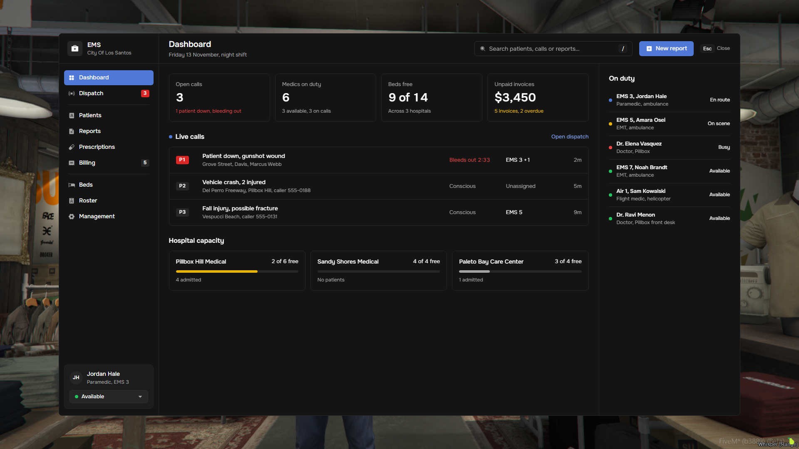

# cobalt_ambulancejob

EMS job: downs and revives, treatment, carry, hospitals, check-in and the EMS MDT.

Documentation: https://docs.projectcobalt.net/cobalt_ambulancejob

Part of [Project Cobalt](https://github.com/Project-Cobalt-FiveM), under the [Project Cobalt License](LICENSE).
